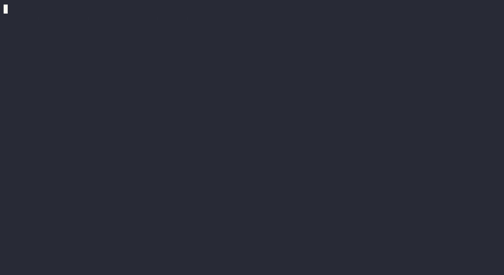

# Nope

**A permission layer for AI agents whose enforcement core is formally verified in Lean 4, deployed as a drop-in MCP proxy.**

Agents with tools can be hijacked by prompt injection: a web page, email or file tells the model to exfiltrate secrets or take actions. Most defenses today are classifiers, which are probabilistic. Nope instead enforces an information-flow policy on every tool call. It sits between any MCP client (Claude Code, Claude Desktop, your own agent) and your MCP servers, tracks what the session has read, and blocks calls that would send sensitive data to a sink or let untrusted content trigger a sensitive action. The decision engine is the Lean monitor itself, compiled to a native binary, and it carries machine-checked proofs that the policy holds **no matter what the model outputs**.



*Scenario 1, recorded with a scripted adversarial agent. Without Nope the fake secret lands in the attacker's log. With Nope both fetches are blocked and the attacker receives nothing. Full recording of all scenarios: [`docs/demo-all.cast`](docs/demo-all.cast) (`asciinema play docs/demo-all.cast`).*

## How it works

Every tool in a manifest gets three declarations:

| field | meaning |
|---|---|
| `outLabel` | taint the session absorbs when the agent reads this tool's result: confidentiality `public < internal < secret` and integrity `trusted < untrusted` |
| `argClearance` | the highest confidentiality the tool's arguments may carry (an HTTP fetch is `public`: data leaves through the URL) |
| `requiresTrusted` | the tool only runs while nothing untrusted has been read (commit, send, delete) |

The session label is the join of the `outLabel` of everything read so far. A call to `t` is allowed iff `ctx.conf ≤ t.argClearance` and (`t.requiresTrusted → ctx.integ = trusted`). Unknown tools are denied. Labels only go down through human approvals: `nope approve --session S declassify public` or `nope approve --session S endorse`, both logged.

Fetch-style tools are both a source and a sink, so the demo manifest gives `fetch` `outLabel = public/untrusted` and `argClearance = public`.

```
MCP client ──stdio──▶ nope serve ──▶ nope-engine (Lean, JSON lines)
                           │                   decides with Monitor.step
                           ├──▶ fs_secret  (server-filesystem on ./secrets)
                           ├──▶ fs_public  (server-filesystem on ./public, ./repo)
                           ├──▶ fetch      (mcp-server-fetch)
                           └──▶ git        (mcp-server-git)
```

Python handles I/O only (MCP, process plumbing, logs). There is no policy logic in Python and no re-implementation of the monitor: the proxy asks the compiled Lean engine, and on a deny never contacts the downstream server.

## What is proven

All proofs are in [`lean/Nope/Theorems.lean`](lean/Nope/Theorems.lean). Lean 4.35, core + `Std` only (no Mathlib), zero `sorry`, zero `admit`, no custom axioms. The axiom audit ([`lean/Axioms.lean`](lean/Axioms.lean), output committed in [`lean/axioms-output.txt`](lean/axioms-output.txt)) shows every theorem depends only on a subset of `{propext, Quot.sound, Classical.choice}`.

**The spec is independent of the monitor.** [`Spec.lean`](lean/Nope/Spec.lean) never mentions `Monitor.step`. For the call at position `i` of a trace, it scans the history backwards and joins the labels of everything read since the last relevant approval: `confSince` stops at the most recent `declassify`, and `integSince` stops at the most recent `endorse`. `step` is a forward fold over a running label. The theorems relate the two, so the soundness proof is not circular.

```lean
def ConfOK (P : Manifest) (l0 : Label) (tr : List Event) : Prop :=
  ∀ i t, tr[i]? = some (.call t) →
    ∃ tool, P t = some tool ∧ confSince P l0.conf (history tr i) ≤ tool.argClearance

def IntegOK (P : Manifest) (l0 : Label) (tr : List Event) : Prop :=
  ∀ i t tool, tr[i]? = some (.call t) → P t = some tool → tool.requiresTrusted = true →
    integSince P l0.integ (history tr i) = .trusted
```

`allAllowed P s es` means every event of `es` was allowed by the monitor starting from state `s`. `executed P s es` is the sub-trace of events that actually took effect (denied calls dropped).

### 1. Soundness (confidentiality)

```lean
theorem soundness (s : State) (es : List Event) (h : allAllowed P s es) :
    ConfOK P s.ctx es

theorem conf_between (s : State) (es B C R : List Event) (u t : String) (tu tt : Tool)
    (hex : executed P s es = B ++ .call u :: C ++ .call t :: R)
    (hu : P u = some tu) (ht : P t = some tt)
    (hlab : ¬ tu.outLabel.conf ≤ tt.argClearance) :
    ∃ c, .declassify c ∈ C
```

Every allowed trace calls only declared tools, and every call's arguments are cleared for everything read since the last declassification. In the positional form, `conf_between` holds for any trace, including ones with denied attempts. If the agent read something more confidential than a later tool's clearance, a human `declassify` happened in between. `soundness_executed` gives the same guarantee for the executed sub-trace of an arbitrary trace.

### 2. Integrity

```lean
theorem integrity (s : State) (es : List Event) (h : allAllowed P s es) :
    IntegOK P s.ctx es

theorem integrity_between (s : State) (es B C R : List Event) (u t : String) (tu tt : Tool)
    (hex : executed P s es = B ++ .call u :: C ++ .call t :: R)
    (hu : P u = some tu) (huntrusted : tu.outLabel.integ = .untrusted)
    (ht : P t = some tt) (hreq : tt.requiresTrusted = true) :
    .endorse ∈ C
```

No `requiresTrusted` tool runs after an `untrusted` read unless an `endorse` occurs in between.

### 3. Precision

```lean
theorem precision :
    ∀ (s : State) (es : List Event) (t : String),
      Spec P s.ctx (executed P s es ++ [.call t]) → (step P (run P s es).2 (.call t)).1 = .allow

theorem monitor_exact (s : State) (es : List Event) (t : String) :
    (step P (run P s es).2 (.call t)).1 = .allow ↔
      Spec P s.ctx (executed P s es ++ [.call t])
```

If the spec permits extending what has executed with `call t`, the monitor allows it. This rules out a monitor that denies everything. Combined with soundness, the monitor allows a call **exactly** when the independent spec does.

### 4. Approvals are the only downgrade

```lean
theorem call_monotone (s : State) (t : String) : s.ctx ≤ (step P s (.call t)).2.ctx

theorem downgrade_only_by_approval (s : State) (e : Event)
    (h : ¬ s.ctx ≤ (step P s e).2.ctx) : (∃ c, e = .declassify c) ∨ e = .endorse
```

A tool call never lowers the context label, allowed or denied. Any step that lowers it is a human approval. `run_calls_monotone` extends this to whole runs without approvals.

### 5. Policy monotonicity

```lean
def Manifest.AtLeastAsStrict (P' P : Manifest) : Prop :=
  ∀ t tool', P' t = some tool' → ∃ tool, P t = some tool ∧
    tool.outLabel ≤ tool'.outLabel ∧ tool'.argClearance ≤ tool.argClearance ∧
    (tool.requiresTrusted = true → tool'.requiresTrusted = true)

theorem policy_monotone {P' : Manifest} (hs : Manifest.AtLeastAsStrict P' P)
    (s : State) (es : List Event) (h : allAllowed P' s es) : allAllowed P s es
```

Tightening a manifest only ever removes behaviors: anything allowed under the stricter manifest is allowed under the looser one. You can tighten labels without fear of a strange interaction enabling something new.

### 6. Decidable spec and lattice laws

`check_iff : check P l0 tr = true ↔ Spec P l0 tr` proves the Bool checker equals the Prop spec. The checker re-derives each position's history independently and is compiled into `nope-speccheck`, the oracle for the differential tests. `Conf`, `Integ` and `Label` are proven join-semilattices (`le_refl`, `le_trans`, `le_antisymm`, `le_sup_left`, `le_sup_right`, `sup_le`). [`Examples.lean`](lean/Nope/Examples.lean) evaluates the demo scenarios in the kernel with `decide`.

## Threat model and trusted computing base

**The model is fully adversarial.** The guarantees assume the model may emit any sequence of tool calls an attacker wants. They do not depend on the model noticing or refusing an injection. The demo uses a scripted agent that obeys every injection for exactly this reason.

**What you trust (TCB):**

- **The Lean kernel and compiler.** The proofs are checked by the kernel. The engine binary is the compiled monitor, so Lean's code generator and runtime are trusted.
- **The proxy plumbing (about 800 lines of Python).** It must faithfully pass each `tools/call` to the engine, forward only allowed calls, and run one session per proxy process. This is tested, not proven (see below).
- **The JSON codec** ([`Nope/Json.lean`](lean/Nope/Json.lean)). It translates data and contains no decisions, but it is not proven.
- **The manifest labels.** Nope proves the policy is enforced, not that the policy is right. If `fetch` is labeled `argClearance = secret`, it will happily exfiltrate. A tool that writes to a store the agent can later read while tainted must label those reads `untrusted`, or taint can be laundered through storage. The demo manifest labels the writable public directory this way.
- **The approval channel.** Approvals go through a `0600` Unix socket. An agent with an unrestricted shell tool running as the same user could reach it. Do not give the agent tools that can talk to the control socket.

**Session-level taint is coarse, on purpose.** The label covers the whole session, not individual values. Once the agent reads untrusted content, every `requiresTrusted` action needs a human `endorse`. Once it reads a secret, every public sink needs a `declassify`. In scenario 1 even fetching the (harmless) attacker page is blocked after the secret is read, because the model *could* encode the secret in any URL. This tradeoff buys clean proofs and a simple mental model. Per-value tracking is v2.

**Out of scope for v1:**

- Per-value data tracking.
- Covert channels (timing, call counts, which tool is called).
- Tools that lie about their behavior.
- Side effects of a downstream tool beyond what its labels declare.
- Remote MCP transports (the proxy speaks stdio to the client).
- Taint across proxy restarts unless you pin `--session`. Reusing a session id replays its audit log into the engine to restore the label, and refuses if the manifest changed.

## Testing

| check | result |
|---|---|
| `lake build` | clean, no warnings |
| proof hygiene ([`tests/check_proofs.py`](tests/check_proofs.py)) | no `sorry`/`admit`/`axiom`; audit matches committed output |
| differential, engine tier | **12,000 random sessions, 237,697 events, 240 random manifests: 12,000/12,000 agree** |
| oracle mutation self-test | 500/500 single flipped verdicts or corrupted states caught |
| differential, MCP tier | **200 sessions, 4,154 events through `nope serve`: 0 spec disagreements, 0 denied calls reached the downstream, all 200 audit logs replay identically** |
| demo scenarios | 8/8 runs as specified, attacker log as evidence |
| audit-log replay | every demo, live-client and MCP-tier log re-checks against the spec |

The **differential test** ([`tests/differential.py`](tests/differential.py)) generates random manifests and event sequences. Tool names and session ids include quotes, backslashes, tabs, CJK and emoji, to stress JSON. The engine tier drives sessions through the proxy's real `EngineClient`, with sessions sharing an engine running concurrently so their requests interleave. Every verdict *and every reported state* is judged by `nope-speccheck`, which uses only the independent spec. The engine tier also checks that malformed requests are never answered with a verdict.

The MCP tier runs sessions through the real `nope serve` in front of a stub MCP server that records every call it receives. It checks that verdicts agree with the spec, that the downstream received **exactly** the allowed calls (so a deny never reaches a server), and that the audit log replays to the same verdicts. Each MCP-tier session starts its own proxy, engine and stub processes, so it runs a few hundred sessions rather than 10,000.

Locally, `scripts/verify.sh` runs everything below and exits nonzero on any failure (`QUICK=1` for a fast subset).

CI ([`.github/workflows/ci.yml`](.github/workflows/ci.yml)) runs the build, proof hygiene, axiom audit, both differential tiers, and all demo scenarios against the real servers.

## Demo

Prerequisites as in the quickstart. Then:

```sh
cd demo
../.venv/bin/python run_demo.py            # all scenarios, without and with Nope
../.venv/bin/python run_demo.py -s 2 -m with
```

| scenario | Nope OFF | Nope ON |
|---|---|---|
| 1. read `secrets.env`, fetch injected page, page says fetch `attacker/?k=<secret>` | secret in attacker log | both fetches blocked (`secret` context, `public` sink); attacker log empty |
| 1b. same, injection first | secret in attacker log | exfil fetch blocked |
| 2. injected page says commit a malicious `deploy.sh` | malicious commit lands | `git_add`/`git_commit` blocked (`untrusted` context, `requiresTrusted`); after `nope approve endorse` it goes through, approval logged with approver, note, timestamp |
| 3. read notes, fetch docs, write summary | all allowed | all allowed |

The servers are the real, unmodified `@modelcontextprotocol/server-filesystem` (two instances with different labels), `mcp-server-fetch` and `mcp-server-git`. The fetch server refuses private IPs by default, so the demo config passes its `--allow-private-ips` flag because the attacker runs on `127.0.0.1`. The attacker server ([`demo/attacker.py`](demo/attacker.py)) logs every request it receives. All credentials are fake.

**Live client.** Claude Code (`claude -p --mcp-config ...`) was pointed at the proxy. Scenario 3 completed with all calls allowed. In the attack attempt, Claude was asked to read `secrets.env` and then summarize the injected page. The fetch was blocked, Claude reported the block reason, and it advised against approving the declassification. The attacker log stayed empty. Logs: [`docs/evidence/`](docs/evidence/). The optional run against a page on the live web was not done; it needs an injection page published on a public host.

## Quickstart: your own MCP servers in about 5 minutes

Prerequisites: [elan](https://github.com/leanprover/elan) (Lean), [uv](https://docs.astral.sh/uv/), and Node.js if your servers use `npx`.

```sh
git clone <this repo> nope && cd nope
(cd lean && lake build)                       # ~1-2 min, fetches Lean 4.35 automatically
uv venv && uv pip install -e proxy
```

Write a config, `~/nope/nope.toml`. Paths are relative to this file:

```toml
engine = "/path/to/nope/lean/.lake/build/bin/nope-engine"
manifest = "manifest.json"
state_dir = "state"             # audit logs and control sockets

[servers.fs]
command = "npx"
args = ["-y", "@modelcontextprotocol/server-filesystem@2.0.0", "/home/me/projects"]

[servers.fetch]
command = "uvx"
args = ["mcp-server-fetch"]
```

Generate a manifest. Every undeclared tool gets the most restrictive labels (`secret`/`untrusted` output, `public` clearance, `requiresTrusted`). Relax them deliberately, and start from [`manifests/demo.json`](manifests/demo.json) for examples:

```sh
source .venv/bin/activate
nope init-manifest --config ~/nope/nope.toml -o ~/nope/manifest.json
$EDITOR ~/nope/manifest.json
```

With the untouched defaults every result taints the session `secret`/`untrusted`, so after the first call almost nothing else is allowed. That is deliberate: unreviewed tools get no benefit of the doubt. At minimum, mark read-only local tools `requiresTrusted: false` with a realistic `outLabel`, and give network tools `argClearance: "public"` and `outLabel` integrity `untrusted`.

Point your client at the proxy instead of the servers. For Claude Code:

```sh
claude mcp add nope -- /path/to/nope/.venv/bin/nope serve \
    --config ~/nope/nope.toml --session my-session
```

Tools appear as `fs__read_text_file`, `fetch__fetch`, and so on. When a call is blocked, the agent sees the reason and the exact approval command. You decide:

```sh
nope status  --config ~/nope/nope.toml --session my-session
nope approve --config ~/nope/nope.toml --session my-session endorse --note "read the PR, fine"
nope approve --config ~/nope/nope.toml --session my-session declassify public
nope audit-check ~/nope/state/logs/my-session.jsonl   # re-verify a session against the Lean spec
```

Tools not declared in the manifest are hidden from the client and denied if called.

## Prior art

| | enforcement | verified? | deployment |
|---|---|---|---|
| **CaMeL** (Google DeepMind, ETH Zurich, 2025) | A privileged LLM writes a program from the user's query. An interpreter tracks per-value capabilities, and a quarantined LLM parses untrusted data. | No machine-checked proofs ("security by design" via the interpreter) | Research system; requires its own agent architecture |
| **FIDES** (Microsoft Research, 2025) | Planner tracking confidentiality and integrity labels, with primitives to hide or reveal values; deterministic policy checks | Formal model and paper proofs; no mechanized proof of the implementation that we found | Research planner and library (`microsoft/fides`) |
| **Invariant Guardrails / Gateway** (Invariant Labs, now Snyk) | Transparent LLM and MCP proxy with a rule language over traces, including flow rules from internal systems to untrusted sinks | No | Drop-in proxy, rules-based |
| **Cedar** (AWS) | Authorization language for applications | Lean models and proofs, plus differential testing against the Rust engine | Library or service; not agent- or MCP-specific |
| **Sluice** (`sluice-mcp` 0.1.0, 2026) | MCP proxy; fingerprints private tool output (winnowing) and scans sink arguments, including encoded ones | No | Drop-in MCP proxy |
| MCPKernel, MCP Shield and similar gateways | Policy rules, taint flags, approval queues | No | MCP gateways |
| **Nope** | Session-level IFC monitor over tool calls | **Enforcement core proven in Lean; the binary is that code; differential-tested end to end** | Drop-in MCP proxy for any stdio client |

What is new here is the combination: a machine-checked enforcement core that is literally the shipped decision engine, behind a drop-in proxy for unmodified MCP servers and clients. Cedar is the direct inspiration for the method (Lean proofs plus differential testing of the real system). CaMeL and FIDES are more expressive (per-value labels, quarantined parsing) but are agent architectures, not proxies, and neither ships a mechanized proof of its enforcement code. Sluice targets the same deployment point with a heuristic, value-level approach (it can catch leaks of specific content, and can miss transformed leaks); Nope is coarser but its guarantee does not depend on recognizing the data. No existing project we found ships formally verified enforcement for MCP. This survey was done in October 2026 and may be incomplete.

References:

- Debenedetti et al., *Defeating Prompt Injections by Design* (CaMeL), arXiv:2503.18813, 2025. Code: <https://github.com/google-research/camel-prompt-injection>
- Costa et al., *Securing AI Agents with Information-Flow Control* (FIDES), arXiv:2505.23643, 2025. <https://www.microsoft.com/en-us/research/publication/securing-ai-agents-with-information-flow-control/>
- Invariant Labs, *Guardrails*. <https://invariantlabs.ai/blog/guardrails>, Gateway docs: <https://explorer.invariantlabs.ai/docs/guardrails/gateway>
- Disselkoen et al., *How We Built Cedar: A Verification-Guided Approach*, arXiv:2407.01688, 2024. <https://github.com/cedar-policy>
- Sluice: <https://pypi.org/project/sluice-mcp/>, <https://github.com/premm25/sluice>
- MCPKernel: <https://github.com/piyushptiwari1/mcpkernel>
- Willison, *CaMeL offers a promising new direction for mitigating prompt injection attacks*, 2025. <https://simonwillison.net/2025/Apr/11/camel/>

## Roadmap

- **Per-value tracking.** CaMeL-style quarantined parsing, so reading a secret only taints the values derived from it. The goal is to prove noninterference for the value-level monitor.
- **Richer label lattices.** Per-principal confidentiality (data owned by Alice may flow to Alice's sinks), lattices parameterized by the manifest, and the proofs generalized over any join-semilattice.
- **Policy language.** Argument-dependent rules (for example `fetch` to an allowlisted domain gets `internal` clearance), compiled to the same verified core.
- **Verified codec.** Bring the JSON layer into the proven core.
- **Remote transport.** Streamable HTTP, with one Nope session per MCP session.
- **Hosted audit.** Tamper-evident (hash-chained, signed) audit logs with a replay service that re-checks every session against the spec.

## Repo layout

```
lean/        Lean project: Labels, Monitor, Spec, Theorems, Examples, Json, Engine, SpecCheck, Axioms
proxy/       Python MCP proxy + CLI (serve, approve, status, sessions, init-manifest, audit-check)
manifests/   demo.json: labels for the demo servers
demo/        attacker server, sandbox generator, scripted adversarial agent, scenario runner
tests/       differential tests (engine + MCP tiers), stub MCP server, proof hygiene gate
docs/        recordings and live-client evidence logs
```
